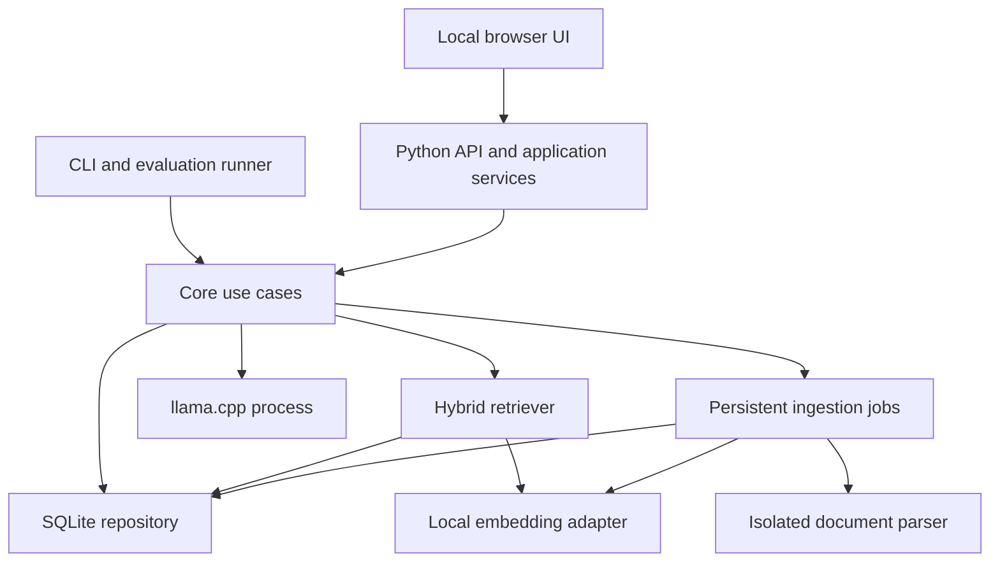

# Professor AI Architecture

Status: implementation baseline, 2026-10-22. The Python package, settings, diagnostics, and health API are implemented. The RAG, storage, inference, and interface sections remain intended behavior, without model or hardware benchmark results.

## 1. Product contract

Build a single-user study assistant whose answers use selected local learning materials. Support multiple collections and both English and Brazilian Portuguese. Start on the maintainer's reported Apple M4-family MacBook with 16 GB RAM, then qualify additional desktop platforms. iPhone execution requires a separate feasibility milestone.

The MVP accepts text PDFs, UTF-8 Markdown, and UTF-8 text. It supports conceptual questions and text-based exercises whose needed information can be recovered from the supplied materials. It returns citations, explains insufficient evidence, and distinguishes derived solutions from source statements. It does not promise universal exam accuracy.

Initial downloads require connectivity. Ingestion, embeddings, retrieval, generation, fonts, rendering, and evaluation must subsequently work without external network access. No telemetry is enabled by default. Do not silently fall back to a cloud provider.

## 2. Language and stack decisions

| Component | Choice | Why this fits the project |
| --- | --- | --- |
| Core and API | Python 3.12; FastAPI; Pydantic 2 | A productive environment for parsing, ML experiments, typed boundaries, and evaluation |
| UI | TypeScript in strict mode; React; Vite | A local browser UI with reusable components and explicit event contracts |
| Generation | llama.cpp in a managed local process; GGUF; Metal | Native inference kernels and a portable runtime boundary |
| Embeddings | Sentence Transformers adapter, local files only after setup | Simple reference implementation; optimize only after profiling |
| Database | Python sqlite3; SQLite with FTS5 and pinned sqlite-vec | Local persistence and search without operating a database service |
| Extraction | pypdf for text PDFs; standard text readers | Small initial parser surface with visible limitations |
| Tooling | uv, Ruff, mypy, pytest; npm, ESLint, Vitest, Playwright | Reproducible environments and checks at the appropriate layer |

Python orchestrates the pipeline; it does not implement tensor operations in Python loops. Heavy inference and vector operations run in native libraries. This is the optimization boundary that matters initially. A Rust rewrite, a distributed database, and a large RAG framework require measured justification.

FastAPI provides the HTTP and schema layer; React provides the component model; Vite builds the client assets; uv manages Python projects and locks. These are design selections, not claims that they are universally faster than alternatives. [FastAPI](https://fastapi.tiangolo.com/), [React](https://react.dev/), [Vite](https://vite.dev/guide/), [uv](https://docs.astral.sh/uv/).

llama.cpp supports Apple Silicon through Metal and supports other hardware backends. MLX is an Apple-specific comparison candidate if benchmarks justify a second adapter. Run inference natively on macOS; Docker is optional for reproducible CPU tests, not the default Mac GPU path. [llama.cpp](https://github.com/ggml-org/llama.cpp), [MLX](https://ml-explore.github.io/mlx/build/html/index.html).

## 3. Component boundaries



Use a modular monolith, not independently deployed services. The API is the single writer to the application database. Parsing and embedding workers return results to the writer. One generation request runs at a time by default; additional requests receive a queue state and can be cancelled. Long ingestion jobs yield at batch boundaries to interactive retrieval.

The production UI and API share a loopback origin. Restrict hosts and origins, use a per-launch session token, and never bind to all interfaces by default. Serve local fonts and sanitized Markdown; document text and model output cannot execute scripts. Model processes receive only prepared context and have no shell or arbitrary filesystem tools.

## 4. Proposed source layout

The settings, app, CLI, and foundation tests exist. Other paths below describe future implementation locations.

```text
src/professor_ai/
  app.py                 # Composition and lifecycle
  cli.py                 # Developer and evaluation entry points
  settings.py            # Validated runtime configuration
  api/                   # HTTP and streaming contracts
  domain/                # Shared value types and provider protocols
  collections/           # Collection and document use cases
  ingestion/             # Parsing, provenance, chunking, persistent jobs
  retrieval/             # Lexical, dense, fusion, evidence selection
  answers/               # Context budgets, prompts, citation validation
  providers/             # llama.cpp and embedding adapters
  storage/               # SQLite repositories and SQL migrations
web/src/                 # React application, organized by feature
tests/{unit,integration,contracts}/
web/tests/               # Browser workflows and accessibility checks
evals/                   # Licensed cases, corpus manifests, runner configuration
benchmarks/              # Reproduction instructions and publishable reports
```

Dependencies point toward core contracts. API handlers and UI components never contain retrieval SQL or prompt construction. Introduce an abstraction when there is a real boundary to test, not a hypothetical plugin marketplace.

## 5. Database and document lifecycle

Use UUIDs for durable entities, SHA-256 for content fingerprints, UTC timestamps, parameterized SQL, foreign keys, and ordered SQL migrations with a migration ledger. Enable WAL and a bounded busy timeout. WAL permits useful read/write concurrency but still has a single writer; use SQLite's backup API rather than copying only a live database file. [SQLite WAL](https://www.sqlite.org/wal.html).

| Entity | Important fields and relationships |
| --- | --- |
| collections | id, name, description, language hint, created_at |
| documents | id, original display name, media type, content hash, managed local path |
| collection_documents | collection_id, document_id; many-to-many membership |
| document_versions | id, document_id, parser fingerprint, source hash, created_at |
| chunks | id, version_id, ordinal, text, heading, page range, offsets, text hash |
| index_generations | id, embedding fingerprint, chunker fingerprint, state |
| indexed_versions | generation_id, version_id, state; only ready versions are searchable |
| embeddings | generation-specific vector table; chunk ID mapping |
| chunks_fts | FTS5 text index tied to chunk IDs and filtered to active versions |
| jobs | id, type, state, attempt, progress, error code, checkpoint |
| conversations/messages | selected collections, content, generation metadata, evidence IDs |
| citation_snapshots | message_id, version/chunk ID, excerpt, page/section metadata |

Original files live in a managed private data directory outside the checkout. The database stores references and extracted content. A backup includes the consistent database, originals, and manifest; model files may be re-downloaded separately.

An import stages a new document version, chunks, and embeddings. Publish readiness atomically only when both lexical and vector search data are complete. Readers keep seeing the previous ready version while replacement work runs. Interrupted imports remain resumable or explicitly failed; they never expose half-indexed content.

The embedding fingerprint includes model ID, immutable revision, dimension, pooling, normalization, prompt prefixes, tokenizer, and inference representation. Never compare vectors across fingerprints. Rebuild into a new generation and atomically switch after validation; old generations remain available for rollback until cleanup.

Removing collection membership does not delete a document still used elsewhere. Global deletion removes originals, versions, chunks, FTS rows, vectors, cached answers, and stored citation excerpts; affected historical messages show that evidence was removed. Backup copies are separately managed and are not claimed to be securely erased. Document deletion must also cancel related jobs and invalidate retrieval caches.

sqlite-vec remains pre-v1 according to its upstream README. Pin a verified release, test native installation on supported systems, and keep the index rebuildable from source data. Do not promise a stable vector-file format across upgrades. [sqlite-vec](https://github.com/asg017/sqlite-vec).

## 6. RAG and ML algorithms

### Ingestion

Validate file type, size, and parser limits. Initial defaults: at most 50 MiB per file, 500 PDF pages, and a 120-second parser timeout. Process one import job at a time. Reject encrypted or corrupt files with specific errors. Detect missing or suspicious extraction and mark it for review; never silently call an external OCR service. pypdf extracts existing text and is not an OCR engine. [pypdf extraction](https://pypdf.readthedocs.io/en/stable/user/extract-text.html).

Normalize whitespace conservatively; preserve equations, units, headings, list order, and source offsets. Start with heading-aware chunks targeting 320 embedding-tokenizer tokens with up to 48 tokens of overlap. Hard-limit the complete embedding input, including prefix and special tokens, to the model's capacity. Preserve paragraph boundaries when possible; oversize paragraphs split deterministically. Tables and complex layouts receive explicit extraction warnings until qualified.

### Retrieval

1. Require explicit selected collection IDs; do not search unrelated collections automatically.
2. Retrieve 30 lexical candidates with SQLite FTS5/BM25 and 30 dense candidates using exact cosine distance. Scope both branches before their top-k selection, using membership and active-generation filters; test this with out-of-scope distractors.
3. Fuse ranks using reciprocal rank fusion: `score(chunk) = sum(1 / (60 + rank))`, with ranks starting at 1. Break ties by stable chunk ID. Do not add raw BM25 and cosine scores.
4. Deduplicate overlapping evidence and select up to six chunks under a 2,400 generator-token evidence budget. At least one qualifying source can be enough; six is a cap, not a minimum.
5. Apply an evidence sufficiency policy calibrated on the development cases. Record its version. Similarity is not a probability and RRF is not a confidence score.

FTS5's BM25 returns smaller scores for better matches; normalize only ranking direction, not meaning. Start with its Unicode tokenizer and evaluate Portuguese accents, inflections, and exact formula terms. Exact vector search avoids approximation error but does not guarantee semantic relevance. [SQLite FTS5](https://www.sqlite.org/fts5.html).

Add a multilingual cross-encoder reranker or maximal marginal relevance only after an ablation demonstrates gains. Trigger an ANN investigation when measured latency misses the target as the corpus grows; do not switch based on an arbitrary document count. Keep an exact-search reference for recall comparisons.

### Generation and validation

Use a small evidence-only prompt, preserve the question's answer choices, and pass sources as untrusted data with stable citation IDs. Give explanations in the requested language. Support `answered`, `insufficient_evidence`, and `conflicting_evidence` answer states, separate from operational failures.

The MVP uses an 8,192-token total context, a 1,024-token maximum answer, and a 60-second generation deadline. Count tokens with the generator's tokenizer before sending a request. Reduce history and evidence to fit; never truncate source identifiers or silently lose the question. Oversize questions receive a clear validation error. Sampling and chat templates are model-specific, pinned settings.

Stream draft text with a visible in-progress state. Emit `validated` only after checking that each citation resolves to supplied evidence and that the answer structure is complete. Invalid citations or interrupted output cannot become a completed answer. Structural citation validation cannot prove semantic support; human evaluation measures that separately.

For derived exercise solutions, cite the principle or formula and present a concise worked explanation, assumptions, units, and result. Do not imply that the original source contains the solved exercise. Deterministic arithmetic checks are a later story with an allowlisted expression grammar, resource limits, and no arbitrary code execution.

### What ML is and is not doing

| Technique | Role | Initial decision |
| --- | --- | --- |
| Pretrained transformer embeddings | Semantic matching across learning materials | Required |
| BM25 | Lexical retrieval for exact terminology | Required; classical information retrieval |
| Cosine similarity / exact kNN | Compare normalized embeddings | Required |
| Reciprocal rank fusion | Combine lexical and semantic rankings | Required; deterministic |
| Pretrained autoregressive LLM | Explain and synthesize selected evidence | Required; quantized local inference |
| Cross-encoder / MMR | Rerank or diversify evidence | Experimental, gated by ablation |
| Logistic or isotonic calibration | Estimate answerability from labeled outcomes | Later, only with enough labels; no arbitrary confidence percentages |
| Fine-tuning / LoRA | Adapt model behavior | Deferred until error analysis proves a need |
| Model training from scratch | Learn a foundation model | Outside the roadmap's initial scope |

## 7. API and UI behavior

Planned resources: `/health`, `/v1/collections`, `/v1/documents`, `/v1/jobs`, `/v1/conversations`, and `/v1/answers`. Version response schemas and generate client types from OpenAPI. Document routes use IDs, never user-supplied filesystem paths.

`POST /v1/answers` creates a job; `GET /v1/answers/{id}/events` emits ordered SSE events: `queued`, `retrieving`, `generating`, `token`, `validating`, and one terminal event (`completed`, `cancelled`, or `failed`). `DELETE /v1/answers/{id}` requests cancellation. Cancellation must stop provider work, not merely hide text. Reconnection returns a terminal snapshot or a bounded replay; it never starts a duplicate generation.

The UI shows collection selection, import status, chat, and an evidence panel. Support 360 px, 768 px, and 1440 px layouts, keyboard operation, accessible names, focus management, and reduced motion. English is the default UI language; Brazilian Portuguese translations are explicit resources. PDFs use physical 1-based page indexes, with printed labels shown separately when available. Text sources use section titles and line spans.

## 8. Operations and release policy

Maintain structured local logs containing timings, IDs, and error categories; omit full prompts and excerpts by default. Debug exports are opt-in and visibly redacted. Record model/runtime revisions with every reproducible benchmark.

Use fast, deterministic checks in PR CI; run real-model evaluation and hardware measurements before releases and default-model changes. Full release gates and target workloads are in [EVALUATION.md](EVALUATION.md). Numeric performance targets are goals, not measured claims.

Keep feature caches keyed by collection revision, model fingerprint, query, and relevant configuration. Initially cache embeddings, not generated answers. Treat disk exhaustion, malformed PDFs, cancelled requests, and incompatible indexes as explicit states.

Deferred work: DOCX/OCR, image questions, native app packaging, additional desktops, and iPhone portability. Each receives its own design and evidence before release, following the [roadmap](ROADMAP.md).
